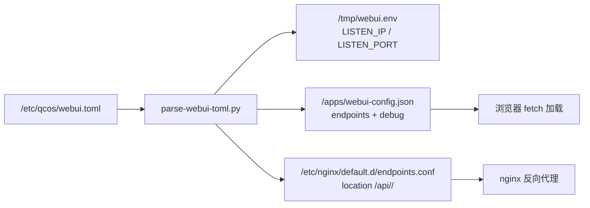

# 量子计算操作系统 QCOS WebUI 安装部署及使用说明

本文档介绍 QCOS WebUI 的部署、配置与启动方法。WebUI 采用 **配置文件驱动** 的方式管理 QCOS API endpoint，支持多 endpoint 配置与免登录切换。

## 目录

- [1. 编译、安装和运行（基于容器，推荐）](#1-编译安装和运行基于容器推荐)
- [2. 编译、安装和运行（调试模式）](#2-编译安装和运行调试模式)
- [3. WebUI 配置文件 `/etc/qcos/webui.toml`](#3-webui-配置文件-etcqcoswebuitoml)
- [4. 多 Endpoint 与 HTTPS](#4-多-endpoint-与-https)
- [5. 常见问题](#5-常见问题)

---

## 1. 编译、安装和运行（基于容器，推荐）

### 1.1 前提条件

保证操作系统已安装 `docker`、`docker-compose` 组件：

```shell
# BCLinux/CentOS/OpenEuler 环境下示例:
yum install -y docker docker-compose
```

### 1.2 编辑 `.env` 配置文件

```shell
cd build-scripts
cp ./env.template .env
vim .env
```

关键项：
- `DEV=false`（生产模式）或 `DEV=true`（开发模式）
- `QCOS_WEBUI_LISTEN_IP` / `QCOS_WEBUI_LISTEN_PORT`（可选，默认 `0.0.0.0:18401`）
- 内网环境按需配置 `NPM_MIRROR` / `NODE_BIN_MIRROR`

### 1.3 编译 qcos-webui 容器镜像

```shell
cd build-scripts
./build-images.sh -w
```

### 1.4 创建/修改 WebUI 配置文件

在宿主机上创建 `/etc/qcos/webui.toml`（参考仓库中的 [`etc/qcos/webui.toml`](../etc/qcos/webui.toml) 模板）：

```shell
sudo mkdir -p /etc/qcos
sudo vim /etc/qcos/webui.toml
```

最小可用配置：

```toml
[DEFAULT]
DEBUG = false
LISTEN_IP   = "0.0.0.0"
LISTEN_PORT = 18401
DEFAULT_ENDPOINT = "local"

QCOS_API_ENDPOINTS = [
  { name = "local", alias = "本地开发环境", url = "http://127.0.0.1:18400" }
]
```

容器启动时，[`entrypoint.sh`](../build-scripts/webui/entrypoint.sh) 会调用 `parse-webui-toml.py` 把该文件翻译成：
- nginx `listen` 地址
- 前端可拉取的 `/webui-config.json`
- 每个 endpoint 的 nginx 反向代理 `/api/<name>/`

详细字段说明见 [第 3 节](#3-webui-配置文件-etcqcoswebuitoml)。

### 1.5 运行容器

```shell
cd build-scripts
./run-docker-webui.sh
```

访问：`http://{QCOS_WEBUI_IP}:18401`

> 容器通过 volume 挂载 `/etc/qcos:/etc/qcos`，因此 `webui.toml` 与 `cacert` 证书文件都要放在宿主机的 `/etc/qcos/` 下（推荐 `/etc/qcos/webui.toml`、`/etc/qcos/ssl/*.pem`），容器内即可读到。

---

## 2. 编译、安装和运行（调试模式）

调试模式直接在宿主机启动 vite dev server，复用同一份 `webui.toml`：

```shell
cd webui
npm install
# 可选：覆盖默认读取的 toml 路径（默认 ../etc/qcos/webui.toml）
export WEBUI_TOML=/path/to/webui.toml
npm run dev
```

启动后访问 vite 提示的地址（默认 `http://localhost:9528`）。

调试模式下：
- `/webui-config.json` 由 vite middleware 实时从 toml 生成，改完 toml 重启 dev server 即可
- 每个 endpoint 的 `/api/<name>/` 由 vite 代理到真实 QCOS API，https endpoint 的 `cacert` 通过 `https.Agent({ ca })` 在校验层生效

---

## 3. WebUI 配置文件 `/etc/qcos/webui.toml`

### 3.1 完整示例

```toml
# ----------------------------------------------------------------------
# QCOS WebUI configuration
#   - Loaded once by the webui container at startup (production), or by
#     the vite dev server (development)
#   - Format mirrors etc/qcos/qcos.toml
# ----------------------------------------------------------------------

[DEFAULT]
# Global debug switch; when true the frontend enables verbose console logs
DEBUG = true

# IP / port the WebUI nginx (production) or vite dev server (development)
# listens on
LISTEN_IP   = "0.0.0.0"
LISTEN_PORT = 18401

# Optional default endpoint name; when set and matches one of the entries
# in QCOS_API_ENDPOINTS, the login page pre-selects it
DEFAULT_ENDPOINT = "local"

# Endpoint health check timeout in milliseconds; the /version probe is
# aborted when no response is received within this window
ENDPOINT_PROBE_TIMEOUT_MS = 3000

# QCOS API endpoints visible to the user.
# Each entry is a TOML inline table:
#   name    - required; unique endpoint identifier (lowercase letters,
#             digits, dash, underscore), stored in browser localStorage
#   alias   - optional; human readable label; falls back to `name`
#   url     - required; base URL of the QCOS API server (http:// or https://)
#   use_ssl - optional; explicit SSL/TLS switch for the upstream QCOS API.
#             Defaults to `true` when `url` starts with `https://` and
#             `false` otherwise. Setting `use_ssl = true` requires the
#             url to be `https://`; setting `use_ssl = false` with an
#             https url disables SSL verification (NOT recommended).
#   cacert  - optional; absolute path *inside the webui container* of the
#             CA certificate used to verify a self-signed https endpoint.
#             Only consulted when `use_ssl = true`; ignored otherwise.
#
# Example (multiple endpoints, https with custom CA):
# QCOS_API_ENDPOINTS = [
#   { name = "local",      alias = "本地开发环境", url = "http://127.0.0.1:18400" },
#   { name = "production", alias = "生产环境",     url = "https://127.0.0.1:18400", use_ssl = true, cacert = "/etc/qcos/ssl/cacert.pem" },
# ]
QCOS_API_ENDPOINTS = [
  { name = "local", alias = "本地开发环境", url = "http://127.0.0.1:18400" }
]
```

### 3.2 字段说明

| 字段 | 类型 | 必填 | 默认 | 说明 |
|---|---|---|---|---|
| `DEBUG` | bool | 否 | `false` | 前端调试开关，true 时控制台输出详细日志 |
| `LISTEN_IP` | string | 否 | `"0.0.0.0"` | nginx/vite 监听地址 |
| `LISTEN_PORT` | int | 否 | `18401` | nginx/vite 监听端口 |
| `DEFAULT_ENDPOINT` | string | 否 | 第一个 endpoint | 默认选中的 endpoint `name` |
| `ENDPOINT_PROBE_TIMEOUT_MS` | int | 否 | `3000` | `/version` 健康探测超时时间（毫秒） |
| `QCOS_API_ENDPOINTS` | array | 是 | - | endpoint 列表，至少一条 |

### 3.3 Endpoint 字段

| 字段 | 类型 | 必填 | 说明 |
|---|---|---|---|
| `name` | string | 是 | 唯一标识，仅允许 `a-z 0-9 _ -`，写入浏览器 localStorage |
| `alias` | string | 否 | 显示名，缺省用 `name` |
| `url` | string | 是 | QCOS API 完整地址，支持 `http://` 或 `https://` |
| `use_ssl` | bool | 否 | 是否对上游启用 SSL/TLS 校验。缺省时按 `url` scheme 推断（`https://` → `true`，否则 `false`）。`use_ssl = true` 要求 `url` 必须是 `https://`；`use_ssl = false` 搭配 `https://` url 会关闭 SSL 校验（不推荐） |
| `cacert` | string | 否 | 自签名 https 的 CA 证书在容器内的绝对路径，仅 `use_ssl = true` 时生效 |

### 3.4 配置文件加载流程



### 3.5 校验规则

- `name`：必填、唯一、正则 `^[a-z0-9_-]+$`
- `url`：必填，scheme 必须是 `http` 或 `https`
- `use_ssl`：可选 bool；缺省时按 `url` scheme 自动推断。`use_ssl = true` 与 `http://` url 冲突会启动失败；`use_ssl = false` 与 `https://` url 冲突会记录警告并关闭 SSL 校验
- `cacert`：仅在 `use_ssl = true` 时校验，必须是 `/etc/qcos/ssl/` 下的可读 regular file，否则解析失败容器启动报错；`use_ssl = false` 时即使配置了也会被忽略（仅记录警告）

---

## 4. 多 Endpoint 与 HTTPS

### 4.1 多 Endpoint 工作原理

1. 配置多个 endpoint 后，登录页与侧边栏会显示 endpoint 下拉框
2. 用户名 + token 按 `endpoint.name` 分别保存在浏览器 localStorage
3. 切换 endpoint 时：
   - 已认证 → 直接刷新页面使用新 endpoint 的 token，**免登录**
   - 未认证 → 自动跳转登录页，登录成功后再切换
4. 每个 endpoint 在 nginx 中有独立的 `location /api/<name>/` 反向代理

### 4.2 HTTPS endpoint、`use_ssl` 与 cacert

由于浏览器的证书校验无法被 JS 控制，WebUI 采用 **nginx 反向代理 + 服务端证书校验** 方案：

```
浏览器 ──http(s)──▶ webui nginx ──https──▶ QCOS API (自签名)
                                       ▲
                              nginx 用 cacert 校验
```

- 前端始终访问同源 `/api/<name>/`，无需在浏览器安装 CA
- nginx 在 `location /api/<name>/` 内通过 `proxy_ssl_trusted_certificate` 校验上游证书
- **每个 endpoint 的 cacert 完全独立**，互不影响

#### `use_ssl` 字段语义

`use_ssl` 是 endpoint 级别的 SSL/TLS 显式开关（参考 OpenStack Neutron 风格），用于显式声明该 endpoint 是否走加密 + 证书校验：

| 配置组合 | 行为 |
|---|---|
| `url = "https://..."` （不写 `use_ssl`） | 自动推断 `use_ssl = true`，启用 SSL 校验 |
| `url = "http://..."` （不写 `use_ssl`） | 自动推断 `use_ssl = false`，纯 HTTP |
| `use_ssl = true` + `url = "https://..."` | 显式启用 SSL 校验（推荐写法） |
| `use_ssl = true` + `url = "http://..."` | **配置冲突**，启动时报错退出 |
| `use_ssl = false` + `url = "https://..."` | 关闭 SSL 校验（仅记录警告），仅用于调试自签名环境，**生产不推荐** |

#### cacert 文件准备

```shell
# 把 CA 证书放到宿主机 /etc/qcos/ssl/ 下，容器通过 volume 挂载访问
sudo mkdir -p /etc/qcos/ssl
sudo cp production-cacert.pem /etc/qcos/ssl/
sudo chmod 644 /etc/qcos/ssl/production-cacert.pem
```

如果上游用的是完整证书链（中间 CA + 根 CA），cacert 文件需要包含完整链：

```shell
cat intermediate.pem root.pem | sudo tee /etc/qcos/ssl/cacert.pem
```

### 4.3 不可用 endpoint 处理

登录页与侧边栏下拉框会对每个 endpoint 调用 `/version` 接口探测：

- **探测中**：显示 Loading 图标 + "探测中…"
- **可用**：显示版本号（如 `v1.8.0`）+ 绿色"可用"
- **不可用**：显示红色"不可用"，鼠标悬停可查看错误原因，**该项禁用选择**

探测超时由 `ENDPOINT_PROBE_TIMEOUT_MS` 控制（默认 3000ms），30 秒内不重复探测以避免抖动。

---

## 5. 常见问题

### Q1：启动后访问 404 或白屏

检查容器日志：

```shell
docker logs qcos-webui
```

常见原因：
- `/etc/qcos/webui.toml` 缺失或 TOML 语法错误 → 看 `parse-webui-toml.py` 报错
- `cacert` 路径不存在或权限不足 → 同上
- nginx 配置生成失败 → 看 entrypoint 输出

### Q2：登录后接口报 401

- 该 endpoint 的 token 已过期：退出登录后重新登录
- 多个 endpoint 之间 token 不共享，切回旧 endpoint 后需要重新登录

### Q3：HTTPS endpoint 提示"不可用"

- 检查 `use_ssl` 与 `url` 是否匹配：`https://` url 必须 `use_ssl = true`（或省略让其自动推断）
- 检查 `cacert` 路径在容器内是否可读：`docker exec qcos-webui ls -l /etc/qcos/ssl/`
- 检查上游 QCOS API 证书是否由该 CA 签发
- 如果是完整证书链，确认 cacert 文件包含中间 CA + 根 CA
- 调试阶段可临时设置 `use_ssl = false` 跳过证书校验定位问题，确认是证书问题后再改回 `true`

### Q4：修改 webui.toml 后没生效

配置文件仅在容器启动时解析一次。修改后需要重启容器：

```shell
cd build-scripts
./run-docker-webui.sh  # 内部会先 down 再 up -d
```

### Q5：忘记所有 endpoint 的登录态

在浏览器开发者工具中清除：
- Cookie：`qcos_active_endpoint`
- localStorage：`qcos_tokens`

或在用户菜单选择"退出所有 endpoint"（如已实现）。

### Q6：dev 模式下端口冲突

vite 默认端口 `9528`。可在 `webui/vite.config.js` 的 `server.port` 修改，或启动时指定：

```shell
npm run dev -- --port 9529
```

---

## 6. 相关文档

- [QCOS 部署手册](../docs/sphinx/source/user-guide/deploy-guide/index.rst)
- [QCOS WebUI 配置与启动](../docs/sphinx/source/user-guide/deploy-guide/config-run-webui.rst)
- [`etc/qcos/qcos.toml`](../etc/qcos/qcos.toml)：QCOS API 服务端配置参考
